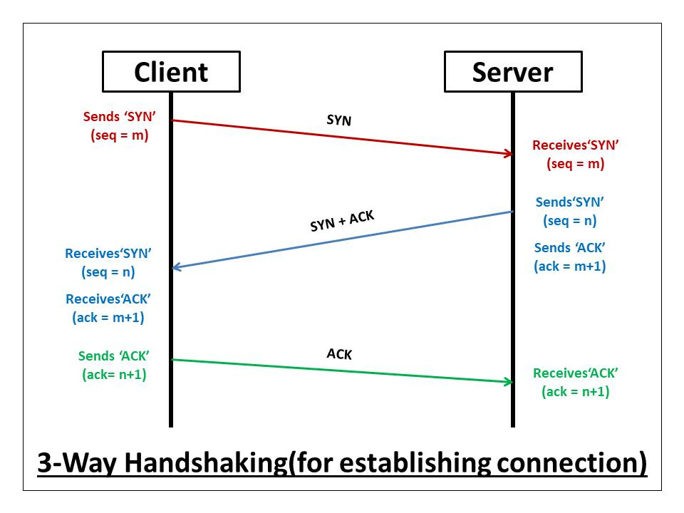

# Chapter 07 — Networking Basics

This chapter is a concise, practical summary of networking concepts and the network stack based on your handwritten notes.

## Overview
- A network is a connection of entities (machines) that share resources and data.
- The Internet is a network of computer networks.

## Network models
Two popular models are used to reason about how protocols and applications interact:
- OSI model (5/7-layer conceptual model)
- TCP/IP model (practical 4/5-layer model used widely)

This chapter uses the simplified 5-layer view (Application, Transport, Network, Data Link, Physical).

## The 5-layer network stack (client → server)
1. Application layer
   - The layer where end-user applications run (web apps, APIs, SMTP, FTP, WebRTC, VoIP).
   - Protocols: HTTP, HTTPS, SMTP, FTP, WebSockets, etc.
   - This is where most application code lives and where you design user interactions.

2. Transport layer
   - Responsible for end-to-end data transfer between processes: TCP (reliable) and UDP (unreliable).
   - Converts application data into segments.
   - Examples: HTTP/websockets over TCP (reliable), DNS/query or RTP over UDP (unreliable when low latency is preferred).

3. Network layer
   - Handles routing of packets across networks using IP (Internet Protocol).
   - Responsible for addressing (IP addresses) and forwarding packets to the correct destination.

4. Data Link layer
   - Sits close to the hardware; implements framing, MAC addressing, and error detection.
   - Logic often lives in NIC firmware, OS drivers, and network hardware (switches, routers).

5. Physical layer
   - The physical medium (wires, fiber, radio) that transfers raw bits.

> Note: In practice the OS kernel + network driver code implements transport/network/data-link responsibilities.

## Flow from the client side (request lifecycle)
1. The user interacts with the application (browser / client app) — Application layer.
2. The application prepares data and hands it to the Transport layer.
3. Transport layer wraps data into segments (TCP) or datagrams (UDP).
4. Network layer wraps segments into IP packets and routes them to destination.
5. Data Link and Physical layers transmit bits on the wire.

When receiving, the server reverses these steps and delivers data up the stack to the application.

## Protocols and rules
- Different tasks use different protocols (SMTP for email, FTP for file transfer, HTTP for webpages).
- Protocols are sets of rules that ensure both sides understand each other.

## What happens when you type a URL in your browser
1. You type `https://www.example.com` (URL).
2. The browser extracts the hostname and asks DNS for the IP address.
3. DNS returns the IP address of the hostname.
4. The client opens a TCP connection to the server IP at the target port (default 443 for HTTPS).
   - TCP uses a 3-way handshake: SYN → SYN-ACK → ACK.
5. On top of the TCP connection, the client sends the HTTP(S) request.
6. Server processes the request and returns an HTTP response.

Key terms:
- IP address: numeric address to identify machines on the network.
- Port: logical endpoint for a specific service on a machine (e.g., 80, 443, 22).
- Protocol: rules and message formats used at each layer.

## TCP vs UDP (quick)
- TCP: connection-oriented, reliable, ordered delivery, congestion control.
- UDP: connectionless, low-overhead, unordered, used when latency is more important than reliability.

## Simple diagrams
Client (App)
-> Transport (TCP/UDP)
-> Network (IP)
-> Data Link
-> Physical

Server (reverse path)

### TCP 3-way handshake

The image above illustrates the TCP 3-way handshake (SYN → SYN+ACK → ACK).

## Examples (referenced files)
Runnable example code is available in the top-level `examples/` folder (repo root). This keeps documentation concise and examples runnable from the project root.

- TCP socket demo (Node.js): [server.js](../../Networking_Basics/tcp/server.js) and [client.js](../../Networking_Basics/tcp/client.js)
- DNS lookup example: [dns-lookup.js](../../Networking_Basics/dns-lookup.js)
- HTTP request example (axios): [http-axios.js](../../Networking_Basics/http-axios.js)

## Example: Building a tiny social app (notes)
- Typical features: register, login, create post, delete own post, view posts, like/comment, follow users.
- Frontend (client) communicates with the backend server over HTTP(S).
- Server exposes REST or GraphQL endpoints; the client talks over TCP/IP to the server IP and port.

