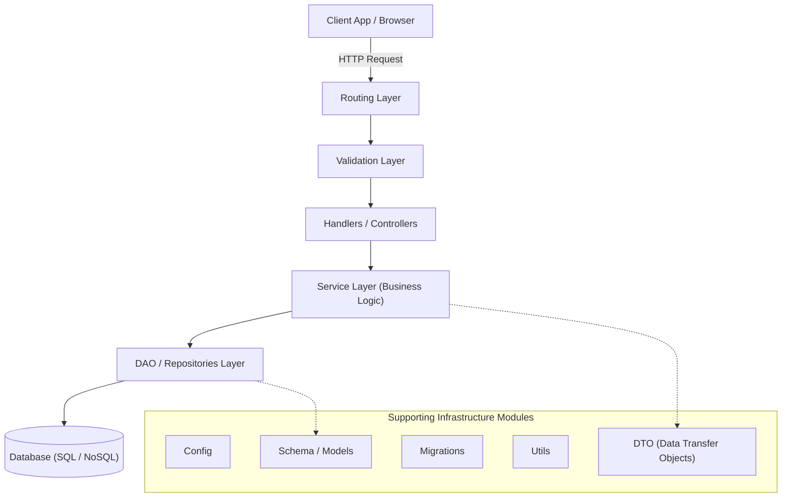

# Day 10 — MVC Architecture and Layered Design

Application design patterns: from traditional Model-View-Controller (MVC) architecture to modern Multi-Tiered / Layered Architecture.
---

## 1. Fundamentals of MVC Architecture

### What is MVC?
MVC stands for **Model-View-Controller**. It is an architectural design pattern used to decouple software applications into three core interconnected components, each with distinct responsibilities.

### Goals of MVC
- **Scalability**: Allows teams to expand applications without monolithic code clutter.
- **Extendibility**: Easy to add new features or components without rewriting existing logic.
- **Maintainability**: Clear separation makes code readable, testable, and maintainable.

---

### The Restaurant Analogy
To understand MVC intuitively, consider how a restaurant operates:

```
┌─────────────────────────────────────────────────────-────┐
│                   Restaurant Analogy                     │
├──────────────┬───────────────────────────┬────────────-──┤
│ Component    │ Restaurant Role           │ MVC Equivalent│
├──────────────┼───────────────────────────┼────────────-──┤
│ Customer     │ Sees menu & eats food     │ View (V)      │
│ Waiter       │ Takes order & returns food│ Controller(C) │
│ Chef         │ Cooks & prepares food     │ Model (M)     │
└──────────────┴─────────────────────────-─┴───────────────┘
```

#### Order Execution Flow:
1. **Customer** selects items from the menu and places an order with the **Waiter**.
2. **Waiter** takes the order and delivers it to the **Chef** in the kitchen.
3. **Chef** (who knows the recipes and business rules for food preparation) cooks the food.
4. **Chef** notifies the **Waiter** when food is ready.
5. **Waiter** delivers the prepared meal back to the **Customer**.

---

### Component Breakdown

#### 1. Model (M) — The Chef
- The **Model** represents the data structure and core business logic implementations.
- It contains rules for data processing, algorithmic computations, and data state manipulation (acting like the Chef preparing food).

#### 2. View (V) — The Menu & Presentation
- The **View** represents what the end customer / user sees (the User Interface or Frontend).
- It formats and presents data to the user.

#### 3. Controller (C) — The Waiter
- The **Controller** acts as the intermediary / orchestrator between View and Model.
- It is responsible for **accepting incoming client requests** and **sending back appropriate responses** (acting like the Waiter delivering orders back and forth).

---

## 2. Code Responsibility, Frameworks & MVC Limitations

### Single Responsibility Principle (SRP)
MVC distributes code based on responsibility. Under the **Single Responsibility Principle (SRP)**, each module or class should have one, and only one, reason to change.

### Case Study: Ruby on Rails (RoR)
- **Ruby**: The underlying object-oriented programming language.
- **Ruby on Rails (RoR)**: An opinionated web framework built on top of Ruby that enforces strict MVC conventions.

---

### Libraries vs. Frameworks

```
┌────────────────────────────────────────────────────────────────────────┐
│                        Libraries vs Frameworks                         │
├──────────────┬─────────────────────────────┬───────────────────────────┤
│ Concept      │ Definition                  │ Examples                  │
├──────────────┼─────────────────────────────┼───────────────────────────┤
│ Libraries    │ Specialized collections of  │ ReactJS, Hibernate,       │
│              │ functions/classes called by │ Sequelize                 │
│              │ developer code.             │                           │
├──────────────┼─────────────────────────────┼───────────────────────────┤
│ Frameworks   │ Collection of libraries     │ Express (opinionated setup│
│              │ dictating overall app       │ with middleware),         │
│              │ architecture & flow control.│ Ruby on Rails, NestJS     │
└──────────────┴─────────────────────────────┴───────────────────────────┘
```

---

### Problems with Traditional MVC in Modern Web Systems
While MVC was a breakthrough for server-side rendered apps, it struggles in modern decoupled backend architectures:

1. **Over-simplification**: Squeezing complex enterprise applications into only 3 buckets (M, V, C) forces controllers or models to become massive "god objects".
2. **SRP Violation at Granular Level**: A single component starts doing input validation, business math, database queries, error formatting, and third-party API integration simultaneously.
3. **Decoupled Frontend-Backend Split**: In modern web development, the frontend UI (React, Vue, iOS, Android) is completely separate from the server API. Server-rendered views are rarely generated inside backend server codebases.

---

### Primary Server Responsibilities in Decoupled APIs
Modern backend servers focus on three fundamental tasks:
1. **Collecting the Request**: Parsing incoming HTTP headers, body, and params.
2. **Processing the Request**: Executing business logic, validations, and database reads/writes.
3. **Giving Response Back**: Returning structured JSON/XML responses to the client.

#### Example API Response Structure:
```json
{
  "status": "success",
  "message": "Create tweet",
  "data": {
    "id": "tweet_12345",
    "text": "Hello World from Layered Node.js!",
    "userId": "user_789",
    "createdAt": "2026-07-25T18:30:00Z",
    "updatedAt": "2026-07-25T18:30:00Z"
  }
}
```

---

## 3. Modern Multi-Tiered / Layered Architecture

To resolve MVC limitations and uphold SRP at scale, modern backend architectures divide applications into specialized layers.

### Architectural Layer Diagram



```
┌────────────────────────────────────────────────────────────────────────────────────────┐
│                        MODERN MULTI-TIERED LAYERED ARCHITECTURE                        │
├────────────────────────────────────────────────────────────────────────────────────────┤
│                                                                                        │
│   Client Request ──► ┌────────────────┐     ┌──────────────────┐     ┌──────────────┐  │
│                      │ Routing Layer  │ ──► │ Validation Layer │ ──► │ Controller   │  │
│                      └────────────────┘     └──────────────────┘     └──────┬───────┘  │
│                                                                             │          │
│                                                                             ▼          │
│    ┌──────────────┐     ┌─────────────────┐     ┌───────────────────────────────────┐  │
│    │ Database     │ ◄── │ DAO Repository  │ ◄── │ Service Layer (Business Logic)    │  │
│    │ (SQL / NoSQL)│     │ Layer           │     │                                   │  │
│    └──────────────┘     └─────────────────┘     └───────────────────────────────────┘  │
│                                                                                        │
├────────────────────────────────────────────────────────────────────────────────────────┤
│                           SUPPORTING INFRASTRUCTURE MODULES                            │
│                                                                                        │
│   ┌──────────┐  ┌───────────────┐  ┌────────────┐  ┌─────────┐  ┌───────────────────┐  │
│   │  Config  │  │ Schema/Models │  │ Migrations │  │  Utils  │  │ DTO (Data Transfer│  │
│   │          │  │               │  │            │  │         │  │     Object)       │  │
│   └──────────┘  └───────────────┘  └────────────┘  └─────────┘  └───────────────────┘  │
└────────────────────────────────────────────────────────────────────────────────────────┘
```

---

### Comprehensive Layer Breakdown

#### 1. Routing Layer
- Inspects the request URL and HTTP method (`GET`, `POST`, `PUT`, `DELETE`).
- Routes requests to the appropriate handler functions, controllers, or classes.

#### 2. Validation Layer
- Ensures incoming request payloads, query parameters, and headers conform to expected schemas (e.g., Zod, Joi, Express-Validator).
- Rejects malformed requests early before reaching business logic.

#### 3. Handlers / Controllers Layer
- Acts as the entry and exit orchestrator.
- Receives validated requests from upper layers, forwards data to the Service Layer, receives calculated responses, and formats the outgoing HTTP response status and body.

#### 4. Service Layer
- **Implements all core algorithmic and business logic**.
- Coordinates complex domain operations and multi-step workflows.
- **Rule**: Service layer does **not** directly write raw SQL/NoSQL queries; it relies on data access abstractions.

#### 5. DAO / Repository Layer
- Dedicated exclusively to **Data Access Objects (DAO)** and database interactions.
- Contains raw database queries (`SELECT`, `INSERT`, `UPDATE`, aggregation pipelines) executed on database servers.

#### 6. Schema / Models Layer
- Defines database table structures, column data types, indexes, and ORM/ODM model definitions (e.g., Prisma schema, Mongoose schema).

#### 7. Migrations Layer
- Tracks versioning and incremental changes to SQL database schemas over time (e.g., adding columns, altering tables).

#### 8. Utils Layer
- Houses reusable helper functions independent of specific business domains (e.g., date formatters, encryption utilities, logger helpers).

#### 9. DTO (Data Transfer Object)
- Defines object shapes transferred across network interfaces (APIs).
- Decouples client payload contracts from internal database storage structures.

---

## 4. DTOs & Repository Abstraction

### DTOs vs. Database Schemas
Network Data Transfer Objects (DTOs) specify what client applications send and receive. DB Schemas define how data is persisted. Keeping DTOs separate from DB Schemas allows internal database refactoring without breaking external API contracts.

---

### Anti-Pattern: Direct DB Access from Service Layer
Directly coupling the Service Layer to a specific database vendor is a bad design practice:

```
❌ Anti-Pattern (Direct Coupling):
Service Layer ───► Direct MySQL Query ("SELECT * FROM tweets...")
Service Layer ───► Direct MongoDB Call ("db.tweets.find(...)")
```
- **Why this fails**: If the team decides to migrate from MySQL to MongoDB or PostgreSQL, every single business logic file in the Service Layer must be rewritten!

---

### Correct Pattern: Repository Pattern (DB Abstraction)

```
✅ Correct Layered Design (Decoupled Repository):
Service Layer ──► Repository Contract (createTweet) ──┬──► MySQL Implementation   ("INSERT INTO TWEETS...")
                                                      └──► MongoDB Implementation ("db.tweets.insert(...)")
```

#### Example Workflow:
1. **Service Layer** requests tweet creation:
   ```javascript
   // Service Layer calls generic repository method
   const newTweet = await tweetRepository.createTweet({ text, userId });
   ```

2. **Repository Layer** executes vendor-specific database command:
   - **MySQL Repo**:
     ```sql
     INSERT INTO TWEETS (text, userId) VALUES ('Hello World', 123);
     ```
   - **MongoDB Repo**:
     ```javascript
     db.tweets.insert({ text: 'Hello World', userId: 123 });
     ```

3. **Repository** converts database output into a standard DTO and returns it to the Service:
   ```javascript
   {
     id: "12345",
     text: "Hello World",
     userId: "atish019",
     createdAt: "2026-07-25T18:30:00Z",
     updatedAt: "2026-07-25T18:30:00Z"
   }
   ```

---

### Benefits of Layered Architecture & Repository Pattern
- **Vendor Agnostic**: Swap underlying storage engines (MySQL $\rightarrow$ MongoDB $\rightarrow$ PostgreSQL) by updating only the Repository layer.
- **Testability**: Service Layer can be unit tested easily by mocking Repository interfaces without needing a real database connection.
- **Maintainability**: Strict separation of concerns keeps every module focused on a single responsibility (SRP).

---

## 5. Summary & Key Takeaways

```
┌────────────────────────────────────────────────────────────────────────┐
│                   Layered Architecture Summary                         │
├───────────────────┬────────────────────────────────────────────────────┤
│ Layer             │ Main Responsibility                                │
├───────────────────┼────────────────────────────────────────────────────┤
│ Routing           │ Map HTTP endpoint/verb to controller handler       │
│ Validation        │ Validate request body, headers, and query params   │
│ Controller        │ Receive HTTP request, delegate, send HTTP response │
│ Service           │ Execute core business and algorithmic logic        │
│ Repository (DAO)  │ Perform database queries and data persistence      │
│ Schema/Models     │ Define database data structures and ORM maps       │
│ DTO               │ Define network API request/response contracts      │
└───────────────────┴────────────────────────────────────────────────────┘
```
